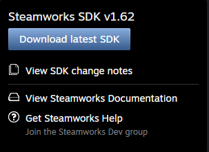
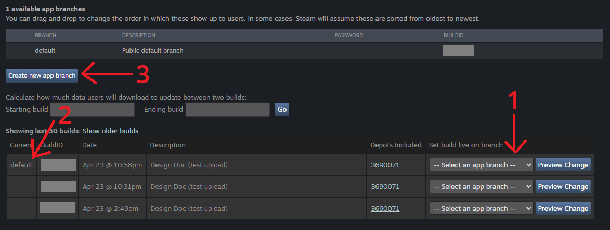
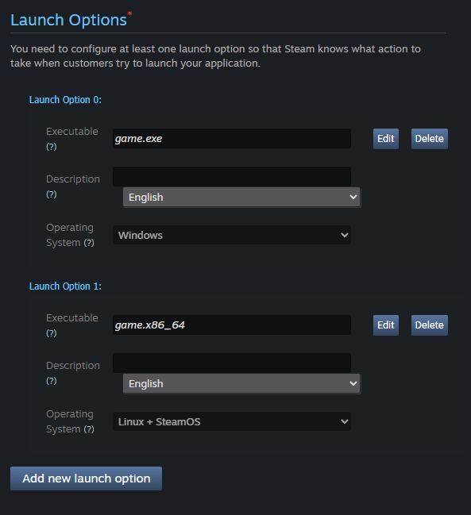

# SteamRoller

A data-driven build and release checklist for the Godot 4 editor. You write the
workflow as an ordered list of steps in a `.tres` config; the plugin docks it as
a checklist with buttons, a console under each row, and gates between steps.

Windows only for now (see *Known limits*).

## Installation

1. Copy this folder into your project at `res://addons/steamroller/`.
2. Enable it in **Project → Project Settings → Plugins**.
3. Copy `addons/steamroller/templates/default_config.tres` outside the addon
   (for example `res://steamroller_config.tres`).
4. Point **Project Settings → Application → SteamRoller → Config Path**
   (`application/steamroller/config_path`) at your copy.
5. The dock appears bottom-right. Its **Start Guide** tab walks through the first
   push to Steam with screenshots.

After editing the config on disk, press **Reload** in the dock's header: it reads
the file again and rebuilds every tab. Reload also stops and abandons a step that
is running: the way out of a run that can no longer finish (a script error, or the
plugin's scripts reloaded underneath it), which would otherwise keep every button
disabled.

## How a step looks

Each step is one `SteamRollerStep` resource. Its `action` says what it does; the
fields that action does not use are ignored. A step renders as one row:

```
[x] Display name               a checkbox: the step is done (INPUT: label + text field)
    Description in BBCode,     ${NAME} variables resolved
    paths shortened to ...
         [ Button ] [ Button ] the step's buttons, then those of the steps attached to it
    console                    the row's output, hidden until a line arrives
─────────────────────────────────────────
```

A step with no `display_name` has no header line.

### Step fields

| Field | Meaning |
|---|---|
| `id` | Stable identifier: what `depends_on`, `attach_to` and `step_ids` name. A step with no id cannot be ticked, gated on or attached to. |
| `action` | What the step does (table below). |
| `display_name`, `description` | The header text, and BBCode under it. |
| `depends_on` | Steps that must **all** be ticked before this step's buttons are enabled. |
| `depends_on_any` | Steps of which **at least one** must be ticked ("record gameplay *or* copy the saves"). Applies together with `depends_on`. |
| `also_ticks` | Steps ticked along with this one: it stands in for them (the template's Copy saves ticks Record gameplay). Only a tick carries; unticking this step leaves them. |
| `button_label` | Button text; empty = the action's default. |
| `attach_to` | The id of the step whose row shows this step's buttons. The attached step has no row of its own but keeps its own id, completion, gating and output. |
| `new_button_row` | Attached steps only: start a new line of buttons in the host row. |
| `confirm_text` | A question asked first; the step runs only on OK. Empty = none. |
| `params` | Action-specific parameters (table below). Strings, also inside arrays and dictionaries, have their variables resolved. |

A disabled button's tooltip says what it is waiting on.

### Actions

| Action (stored value) | What it does | `params` |
|---|---|---|
| `CHECKBOX` (0) | A manual tick. | |
| `NEW_TAB` (1) | The steps after it go on a new tab named `tab_name`. | |
| `INPUT` (2) | A text field bound to a project setting (`project_setting_path`) and a variable (`target_variable`). Done while it holds text, unless `require_non_empty` is off. Each keystroke updates the setting in memory; `project.godot` is written when the field is left, on Enter, or before any step runs. An empty setting takes `default_value`. | |
| `RUN_GDUNIT` (3) | Runs every GdUnit4 test, then reads the run's JUnit report under `res://reports`: a failure fails the step. Disabled when GdUnit4 is missing. | |
| `RECORD_MOVIE` (4) | Plays the main scene under Movie Maker, then optionally re-encodes the film to H.264 with ffmpeg and deletes the film. The movie path is set only for that launch; `project.godot` never stores it. Its extension picks the writer (`.avi` in the template). | `output_path`, `reencode`, `crf` (23), `preset` (`medium`), `suffix` (`_sample.mp4`) |
| `DELETE_FOLDER` (5) | Deletes a folder and its contents, then optionally creates folders. Refuses a drive, a top-level folder, the home folder, or the project or a folder holding it. | `path`, `paths` |
| `CREATE_FOLDERS` (6) | Creates folders. | `paths` |
| `ARCHIVE_FOLDER` (7) | Copies a folder into another, newer files only (`xcopy /D`), so archiving twice is safe. | `source`, `destination` |
| `CLEAR_USER_DATA` (8) | Deletes everything in `user://` (saves, settings, logs) and leaves the empty folder, without asking (`confirm_text` adds a question). Anything else that saves there, such as an installed copy of the game, loses its data too: give editor runs a folder of their own (below). | |
| `OPEN_IN_EXPLORER` (9) | Opens a folder in the file manager. | `path`, `create` (make it first) |
| `COPY_TO_CLIPBOARD` (10) | Copies text. | `text` |
| `RESET_AND_INCREMENT` (11) | Adds one to the last number of `application/config/version`, clears the commit message, unticks every step, clears every console, and shows the first tab. | |
| `RUN_COMMAND` (12) | Runs `executable` with `args` in `working_dir`; a non-zero exit fails the step unless `require_zero_exit` is off. | |
| `RUN_STEPS` (13) | Runs the steps in `step_ids` in order, ticking or unticking each by its result. A step that is not yet enabled is skipped and named, so an aggregate never runs ahead of its children's gates. Button overrides (Debug/Release) pass down. | |
| `WRITE_VDF_DESC` (14) | Writes the Steam build description, and optionally the branch it goes live on, into app build VDF files. Quotes and backslashes are escaped. | `files`, `desc`, `branch` |
| `EXPORT_PROJECT` (15) | Exports headlessly like the editor's **Export All**: two buttons, Debug and Release, each exporting every preset to its own export path. Locked once done, until Reset. | `debug` (one button), `exports` (`[{preset, output}]`) |
| `RUN_COMMAND_ASYNC` (16) | Removed in 0.3: runs as `RUN_COMMAND`. Kept so old configs load. | |
| `RENDER_QUEUE` (17) | A batch of renders: see *Render queue*. | `inputs`, `jobs`, `out_dir`, `work_dir`, `keep_work` (set by the row; the last three override the step's fields) |

New actions are only ever appended: configs store the number.

### Running, Stop and Reset

- While a step runs, every other button is disabled except **instant** ones
  (`OPEN_IN_EXPLORER`, `COPY_TO_CLIPBOARD`), which run at once beside it. Copying
  the commit command during an hour-long export is fine.
- The running step's button reads **Stop**. Stop ends its process and everything
  that process started (`taskkill /T`), or the play session it started, and a
  batch or a chain of steps stops before its next item.
- A ticked step shows a check icon on its buttons, the row's own step and
  attached ones alike, whether it ran successfully or was ticked by hand. The
  row's checkbox sets the same tick by hand, to skip a step.
- **Reset** (`RESET_AND_INCREMENT`) never ticks itself; give it a `display_name`
  such as "Reset this panel and increment the build".

### The Demo toggle

The header's **Demo** switch sets `application/steamroller/demo_mode`. Exports
know their edition from a `demo` or `full` feature tag, so the switch is for
editor runs: a game that wants to preview its demo from the editor reads the
setting when `OS.has_feature("editor")` is true. The plugin itself does not change
how the game runs.

### Editor runs and the save folder

A game run from the editor saves in `${USER_DIR}`. A project can give editor runs a
folder of their own with a feature override,
`application/config/custom_user_dir_name.editor`, so test saves stay out of the
folder Steam Cloud syncs for the exported game. `${USER_DIR_FULL}` is then still the
exported game's folder. The template's Copy saves reads only `${USER_DIR}` (and the
Deck test build's folder): an exported game's folder holds its players' saves.
The Deck test build can get its own folder the same way: a custom feature on its
preset and `custom_user_dir_name.<feature>` (see `--clear-user-dir` below).

## Variables

Steps write `${NAME}`. The config's own `variables` may use other variables
(`"BUILDS_DIR": "${PROJECT_DIR}../builds"`). The built-ins are added on top:

| Variable | Value |
|---|---|
| `${VERSION}` | `application/config/version` |
| `${APP_NAME}` | `application/config/name` |
| `${COMMIT_MESSAGE}` | `application/config/commit_message` |
| `${COMMIT_MESSAGE_SLUG}` | the message as a folder name: lower case, `[a-z0-9_-]`, spaces as `_` |
| `${STEAM_BRANCH}` | `application/steamroller/steam_branch` |
| `${DEMO_MODE}` | `true` or `false` |
| `${USER_DIR}` | `user://` as the editor resolves it, absolute: where the game saves when the editor runs it |
| `${USER_DIR_FULL}` | where an exported full build saves (`config/custom_user_dir_name` without the editor's overrides); the same folder as `${USER_DIR}` unless the project names a `.editor` one |
| `${USER_DIR_DEMO}` | the demo export's user folder (`config/custom_user_dir_name.demo`), or empty |
| `${PROJECT_DIR}` | `res://`, absolute, with a trailing slash |
| `${PLATFORM}` | `OS.get_name()` |
| `${GODOT_EXE}` | the running editor's executable |

An INPUT step's `target_variable` holds its field's current text. An undefined
variable is warned about once and left as written, so a typo shows in the command
it broke. Arguments are quoted for cmd.exe as needed; an empty one is passed as
`""`.

## Render queue

A `RENDER_QUEUE` step turns files into videos (or anything else) in a batch. Its
row offers:

- **Source**: each folder under `render_scan_dirs` that holds inputs, newest first;
- **Film with** (with `render_build_exe` and `render_version_pattern`): *the build
  it sits in* or *the build that recorded it*, starting at `render_build_from`
  (below);
- the **inputs** found in it: every file matching `render_pattern`, and with
  `render_include_folders` every folder that holds some, as one input; select any
  number. With `render_length_pattern` (a regular expression whose first group is
  seconds, matched against an input's last lines) each shows its length, a
  folder the sum of its inputs';
- one **checkbox per job** (`render_jobs`), ticked as the job's `checked` says;
- **Render selected**, which runs every selected input through every ticked job,
  one after the other; a job that fails is named at the end and the batch goes on.

A job (`SteamRollerRenderJob`) is an `id`, a `label`, a `description` (the
tooltip), `settings` and `passes`. A pass (`SteamRollerRenderPass`) is a command,
run like `RUN_COMMAND`, with `ok_exit_codes` and an `echo_pattern` (a regular
expression; only matching lines reach the console, every line is in the log).
Passes may use, besides every variable above:

| Variable | Value |
|---|---|
| `${INPUT}` | the input, absolute |
| `${INPUT_NAME}` | a file as `<parent folder>_<name without extension>`, a folder as its name |
| `${INPUT_DIR}` | the input's folder |
| `${INPUT_HOME}` | a folder input itself, a file input's folder |
| `${INPUT_STEM}` | a folder's name, a file's name without extension |
| `${INPUT_SOURCE}` | the **Source** folder the input was found in: the scan root's subfolder it sits under (the root itself for the root's own inputs) |
| `${JOB_ID}` | the job's id |
| `${OUT_DIR}` | `render_out_dir` (which may use every variable here but itself, so `${INPUT_HOME}` puts each result beside its input and `${INPUT_SOURCE}` at the top of its source folder; name results with `${INPUT_NAME}` there, so two inputs of one name in different folders stay apart), created if missing |
| `${WORK_DIR}` | a scratch folder for this input and job under `render_work_dir` (default: the OS cache folder), deleted when the job succeeds, kept when it fails |
| `${BUILD_EXE}` | with `render_build_exe`: the build's game, copied into `${WORK_DIR}` |
| `${BUILD_DIR}` · `${BUILD_VERSION}` | with `render_build_exe`: the build's folder, and the version read from the input |

**An exported build per input.** With `render_build_exe` set (the game inside a
build folder, `game_depot/Game.exe`), each input runs on an exported build instead
of the editor. Two builds can run it:

- **the build it sits in**: the nearest folder above the input that holds the game.
  A recording copied into a later build (`latest`, say) is there to be filmed by
  that build: again after a fix, or for a before and after;
- **the build that recorded it**: `render_version_pattern` is a regular expression
  whose first group is the version, read from the input's first line (a folder
  input: its last input's, in natural order); the build is the scan root's folder
  named that version, or starting with it and `_` (the archive step's
  `${VERSION}_${COMMIT_MESSAGE_SLUG}`), the newest if several. A recording made by
  an old version plays on that version.

`render_build_from` picks one (`HOME`, the default, or `RECORDED`), and the row's
**Film with** changes it for a batch. Each stands in for the other when it has no
game (a version never archived, no game above the input), and the console says
which build filmed each input and why. The game is copied into `${WORK_DIR}` with
its `.pck` and this platform's libraries, and the job's `override.cfg` beside it,
where an export reads it: a build folder is never written, and an export template
has no `--main-pack` to load a pack from elsewhere. Passes run `${BUILD_EXE}`
without `--path`.

**Project settings for one job.** The step's `render_settings` and the job's
`settings` (`{"section/key": value}`) are written to an `override.cfg` while the
job runs, so the game a pass launches reads them and `project.godot` never
changes: beside the copied build's game (above), or else the project's own, which
the editor binary reads with `--path`. The project's file carries a
`[steamroller]` mark; one without it is the project's own, and a batch refuses to
start while it exists. One left behind by an editor that closed mid-job is removed
when the plugin loads. Gitignore `override.cfg` in the project. Do not export or
play from the editor while such a batch runs: they would read the job's settings
too.

**The film's window.** An exported game whose project starts fullscreen ignores
`--windowed` and `--resolution`; fullscreen then draws the 3D at the screen's size
and Movie Maker shrinks it into the project's size. Set the window in
`render_settings` instead, which every exported build reads, old ones included:
`display/window/size/mode: 0` with `display/window/size/window_width_override` /
`_height_override` (Movie Maker records the window; the canvas keeps the project's
base size).

Sunset Painter's config is a full example: four film jobs over stroke tapes, each
a Movie Maker pass of an exported build (`--write-movie` to an AVI,
`--fixed-fps`) and an ffmpeg pass writing the mp4 beside the tape, with
`application/config/custom_user_dir_name` set for the film so it keeps out of the
player's saves.

## Copy saves: `deck/pull_saves.sh`

```
pull_saves.sh --dest DIR [--local DIR]... [--deck auto|DIR]... [--deck-prefix PREFIX]
              [--exclude PATTERN]... [--require-deck] [--dry-run] -- SUBDIR...
```

Merges each `SUBDIR` (say `saves`, or `sunsets photos`) of every source folder
into `DEST/SUBDIR`. With `--deck-prefix` every file from the Deck arrives with
PREFIX before its first name below `SUBDIR` (`sunsets/Sunset_0/tape_0.tape` →
`sunsets/Deck_Sunset_0/tape_0.tape`): for a game whose save names repeat from
one machine to the next, so the Deck's never mix with this PC's under one name.
A file is copied when the destination lacks it or the
source's copy is newer; a file with the same contents is left alone whatever its
date; sources are never changed. Two sources holding different contents under one
name (a save edited on two machines between syncs) is a **conflict**: the newer
copy is kept and a `conflict:` line names the file and both sources. Steam
Cloud's `steam_autocloud.vdf` markers and `*.tmp` files are never copied
(`--exclude` adds patterns); a `--local` folder given twice is read once. `--deck auto` is the
user folder of the build `deploy.sh` pushes, as `deploy.sh --print-user-dir`
names it, and nothing else: a copy of the game installed from Steam saves for its
player. An unreachable Deck is a warning
and the local folders are still copied, unless `--require-deck`. The template
wires it as **Copy saves** beside **Record gameplay** (`--local ${USER_DIR}
--deck auto --deck-prefix Deck_`, ticking Record gameplay too), into
`${BUILDS_DIR}/latest`, where the archive step keeps them with the build; edit
the folder names after `--` for your game.

## SteamPipe (steamcmd)

Steam uploads use Valve's SteamPipe ContentBuilder, which cannot be bundled.

1. Download the Steamworks SDK from <https://partner.steamgames.com/>.

   

2. Extract it beside your project. The template expects
   `${PROJECT_DIR}../steamworks_sdk/`; change `STEAM_CMD_PATH` and `VDF_DIR` to
   put it elsewhere.
3. Put your app's build script at
   `steamworks_sdk/tools/ContentBuilder/scripts/app_<APP_ID>.vdf`.
4. Run `steamcmd.exe` once by hand to cache the login.

`WRITE_VDF_DESC` writes the version and message into each VDF's `desc` before a
push, so Steam's build history is labelled, and with `params.branch` the branch
the build goes live on (`${STEAM_BRANCH}`, a persisted INPUT).

### First push to Steam

The first upload may report a failure because the `beta` branch does not exist
yet. Set one build live on the default branch, then create `beta` in the
Steamworks dashboard:



Before players can install, add Windows and Linux launch options under
**Installation → General Installation** matching your depot output:



## Itch (butler)

butler is not redistributed here. Download it from
<https://itch.io/docs/butler/>, put `butler.exe`, `7z.dll` and `c7zip.dll` in
`addons/steamroller/butler-windows-amd64/` (gitignored), and run `butler login`
once.

## Steam Deck (devkit): `deck/deploy.sh`

`deck/deploy.sh` takes the project from an edit to a running build on a Steam
Deck, in Game Mode, through the SteamOS devkit's device-side tools
(`~/devkit-utils`, installed when the Deck is paired with the SteamOS Devkit
Client once; after that the whole loop is ssh):

| step | what runs | where |
|---|---|---|
| export | `godot --headless --export-debug <preset>` | workstation |
| prepare | `steamos-prepare-upload --gameid <title>` | Deck |
| stop | `pkill` the running title | Deck |
| sync | `sha256sum` both ends, `scp` only what differs, prune extras | both |
| register | `steam-client-create-shortcut` (argv + compat tool) | Deck |
| launch | `steam-devkit-rpc run-game` | Deck |

Setup, once per machine:

```bash
cp addons/steamroller/templates/deck.env.example data/deck.env   # fill in DECK_HOST, GODOT_BIN
bash addons/steamroller/deck/deploy.sh --doctor
```

`data/deck.env` holds the Deck's address and the Godot binary; gitignore it.
Everything else is derived from `project.godot`: the devkit title from
`application/config/name`, the Deck-side `user://` from the preset's own user
folder (`custom_user_dir_name.<feature>` for one of its custom features, else
`custom_user_dir_name`, else the name), the export folder from the preset's `export_path` (default
preset `Deck_Testing`; keep it out of the depot folders), and the wipe guard from
`BUILDS_DIR` (default `<project>/../builds`). `--env FILE` reads another file.

Flags: `--release`, `--no-export`, `--no-launch`, `--launch` (re-register and run
what is on the Deck), `--stop`, `--debugger[=HOST]` (appends
`--remote-debug tcp://HOST:6007`; the editor needs *Debug > Keep Debug Server
Open*), `--clean-cache` (clears the shader caches under the Deck's `user://`;
saves, logs and prefs are kept), `--clear-user-dir` (deletes the build's whole
`user://` on the Deck before the launch, for a fresh first run; refused, before
anything is exported, when another preset's export resolves to the same folder,
since an installed Steam copy saves there), `--print-user-dir` (prints that
folder and exits; `pull_saves.sh` asks it), `--tail` (follow the Deck's
`user://logs/godot.log` until the game exits), `--run ARGS...`, `--doctor`,
`--dry-run`. Every failure prints an `ERROR` line and exits 1.

**The registered argv is the Deck's play button, so `--run` and `--debugger` args
are transient.** Once the game's pid is up the shortcut is restored to the bare
binary, so a `--run --bench` gate never leaves the benchmark wired to the play
button. `--no-launch` cannot restore it and warns instead (`deploy.sh --launch`).

The template wires it as **Build + run on Deck** (`RUN_COMMAND` through
`${BASH_EXE}` with `${DECK_SCRIPT} --clean-cache`); a project whose Deck test build
has its own folder can pass `--clear-user-dir` instead.

### Benchmark: `deck/bench.sh`

`bench.sh <windows exe> [linux preset] [results file]` runs an exported build with
`--bench` three ways and prints one result line each: Windows Vulkan, then Windows
D3D12 (a smoke test), and in parallel the Steam Deck through
`deploy.sh --no-export --tail --run --bench` (the number to read). The game's side
of the contract: started with `--bench` it prints one line beginning `BENCHMARK`
and quits (`--benchmark` is an engine flag). Each run is wrapped in `timeout`
(`BENCH_TIMEOUT`, default 300 s); a run with no `BENCHMARK` line is `FAILED` and the
script exits 1. Every run appends a dated block to the results file (default
`<exe dir>/../benchmark.txt`).

## Logs

Every external process runs through one helper: `create_process` with stdout and
stderr redirected to a log file, polled from a coroutine, so the editor stays
usable for the whole run. Logs live in `<OS cache folder>/steamroller_logs/<project>/`
(outside `user://`, which `CLEAR_USER_DATA` deletes), named
`<timestamp>_<seq>_<step>.log`; the newest `logs_kept` (30) are kept. A failed
step whose output was quiet or filtered shows its log's path and last lines.

The config's **Advanced** group holds the poll interval, the heartbeat, how many
lines a failure echoes, how many logs are kept, the buttons' width and the render
list's height.

## Known limits

- **Windows only.** The shell is cmd.exe; folders are deleted and archived with
  `rmdir` and `xcopy`; Stop uses `taskkill`. The Deck scripts need Git for Windows'
  bash.
- **Output arrives when a process exits.** While cmd.exe holds the redirect open,
  Godot cannot open the log (it asks for read access without sharing writes), so a
  heartbeat line (`… still running (2m05s)`) marks progress meanwhile: one line in the
  console that updates in place, kept out of the Output panel. Live output would need
  `OS.execute_with_pipe` and a reader.
- `RUN_GDUNIT` reads GdUnit's report files; with none, it passes and says so.
- The commit message lives in Godot's own `application/config/` section
  (`commit_message`), so outside tools find it beside the version.

## Migrating a 0.2 config

0.2 marked a step that joins the row above as `is_optional = true` (with
`new_button_row` for a second line). That still loads and works, and the dock
prints a note. To migrate: replace each `is_optional = true` with
`attach_to = "<id of the row's step>"`, give every attached step an `id`, and give
a step used twice (say an "Open build folder" on two rows) one sub-resource per
use. An attached step now honours its own `depends_on`. `RUN_COMMAND_ASYNC` runs
as `RUN_COMMAND`; `tail_file` is gone.
